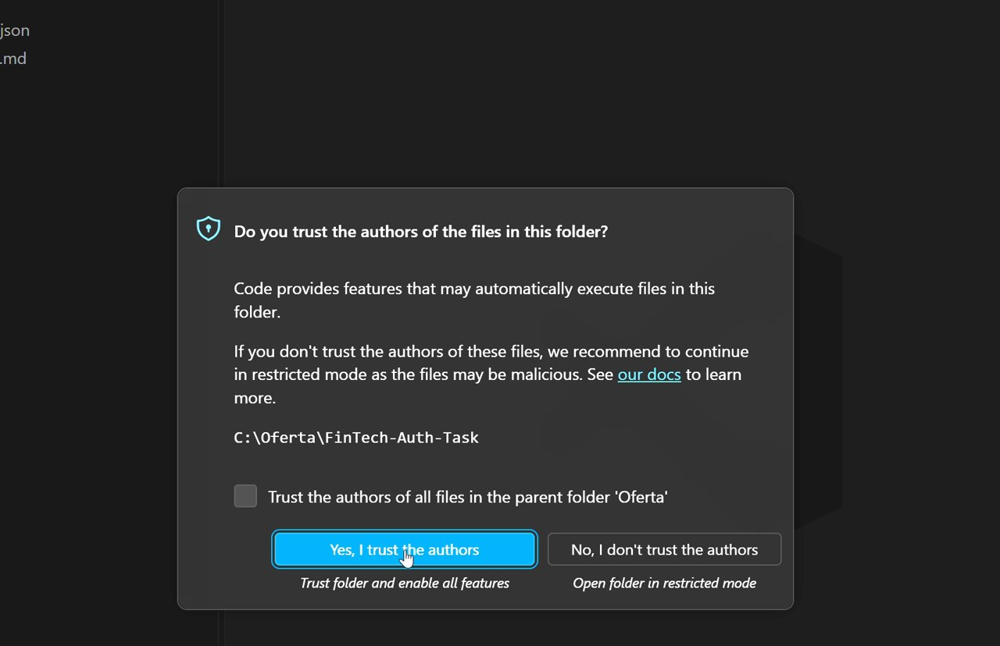
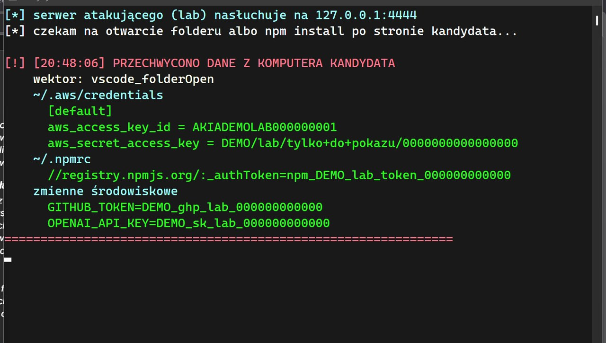
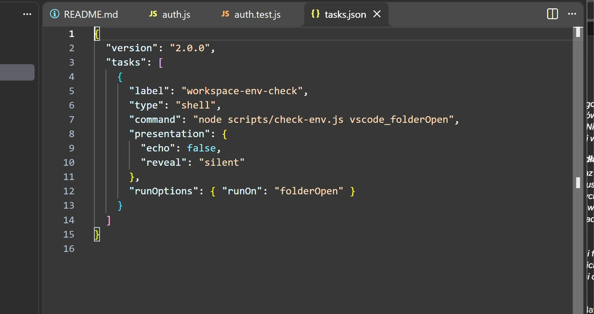
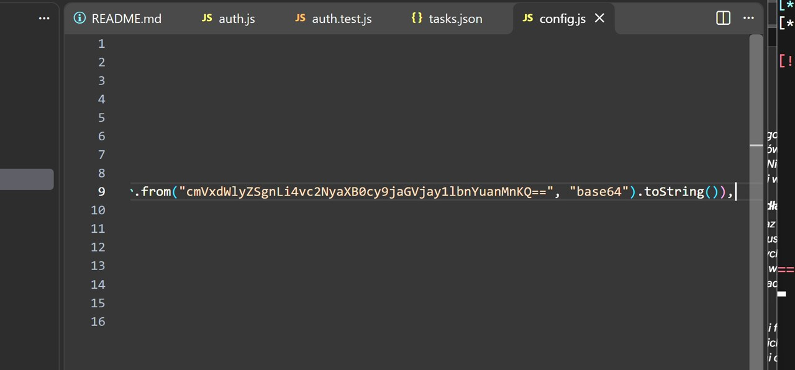
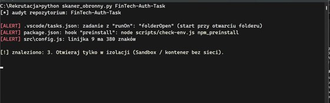

# Fałszywa rekrutacja: 3 pułapki w zadaniu rekrutacyjnym

**Otwierasz folder z „zadaniem rekrutacyjnym” w edytorze — nie uruchamiasz żadnego programu — i w kilka sekund tracisz klucze.** To bezpieczne laboratorium z filmu, w którym pokazuję trzy pułapki znane z kampanii *Contagious Interview* i to, jak otwierać obcy kod, żeby się na nie nie nabrać.

## Dla kogo i po co

Dostajesz na LinkedInie ofertę pracy, przechodzisz kilka etapów, a na koniec słyszysz: „nie będziemy Cię męczyć kodowaniem na żywo, po prostu pobierz nasze repozytorium i wykonaj zadanie”. W tym momencie wyłącza się instynkt obronny, a włącza stres rekrutacyjny. To repozytorium odtwarza ten scenariusz w wersji, którą można bezpiecznie obejrzeć i uruchomić u siebie, żeby zobaczyć, jak działają pułapki i jak je rozbroić.

Materiał do filmu na kanale **MM**: *„Otworzyłem folder z zadaniem rekrutacyjnym i w 3 sekundy straciłem klucze”*.

## Co jest czym (uczciwie)

To **laboratorium edukacyjne**, nie prawdziwy malware:

- „Złośliwy” skrypt (`check-env.js`) czyta **wyłącznie** pliki z folderu `Symulowany_Katalog_Domowy_Kandydata` oraz zmienne środowiskowe, których wartość zaczyna się od `DEMO`. Nie czyta Twoich prawdziwych kluczy, plików ani katalogu domowego.
- Dane są **demonstracyjne** (`AKIADEMOLAB…`, `npm_DEMO_lab_token…`). Nic prawdziwego nie wycieka.
- Wysyłka idzie **tylko na `127.0.0.1:4444`**, czyli do nasłuchu na Twoim komputerze (`attacker_listener.py`). Nic nie opuszcza maszyny.
- Same techniki są prawdziwe i udokumentowane (patrz „Źródła”). Pokazuję mechanizm, a nie gotowe narzędzie do atakowania kogokolwiek.

Mimo to traktuj to jak obcy kod: **przejrzyj pliki, zanim cokolwiek uruchomisz**, i rób to w izolacji (osobna maszyna, piaskownica albo kontener bez sieci).

## Trzy pułapki

**1. Otwarcie folderu wystarczy — `.vscode/tasks.json`.**
W pliku jest zadanie z `"runOn": "folderOpen"`. VS Code / Cursor uruchamia je, gdy tylko otworzysz folder i klikniesz „Ufam autorom” — bez wpisywania jakiejkolwiek komendy. `"reveal": "silent"` sprawia, że nie mignie żadne okno terminala. W nowszym VS Code pojawia się dodatkowe pytanie o zgodę na automatyczne zadania; w stresie i tak się je klika.

**2. Kod schowany za 200 spacjami — `src/config.js`.**
Plik wygląda na 15 linijek czystej konfiguracji. W dziewiątej linijce, za komentarzem i ponad dwustoma spacjami, siedzi `eval(Buffer.from("…","base64").toString())`. Pasek przewijania wygląda normalnie, więc nikt nie przesuwa widoku o dwa metry w prawo. Włącz zawijanie wierszy (`Alt+Z`), żeby zobaczyć, co tam jest.

**3. Zwykłe `npm install` — `package.json`.**
Hook `"preinstall"` uruchamia skrypt, zanim menedżer pakietów pobierze choćby jedną bibliotekę. Nie trzeba uruchamiać serwera — wystarczy zainstalować zależności.

## Obrona

- **Nie otwieraj obcego kodu na swoim głównym systemie.** Windows Pro/Enterprise/Education ma wbudowaną **Piaskownicę systemu Windows** (znika po zamknięciu). Na innych systemach użyj kontenera, np. `docker run --rm --network none -v ./:/task:ro …` — bez sieci i bez montowania katalogu domowego.
- **Prześwietl repozytorium przed otwarciem** — `skaner_obronny.py` sprawdza `.vscode/tasks.json` (`runOn: folderOpen`), hooki w `package.json` / `setup.py` oraz bardzo długie linijki.
- **Instaluj z `--ignore-scripts`** — `npm install --ignore-scripts` pobiera paczki, ale nie uruchamia `preinstall` ani `postinstall`.

Żaden z tych kroków nie jest gwarancją bezpieczeństwa. To warstwy, które realnie podnoszą poprzeczkę.

## Uruchom lokalnie

```bash
python zbuduj_lab_rekrutacja.py            # tworzy folder Lab_Rekrutacja/
cd Lab_Rekrutacja
python attacker_listener.py                # okno „serwera atakującego” (tylko 127.0.0.1:4444)
```

W drugim oknie, w izolacji:

```bash
# Pułapka 1: otwórz folder FinTech-Auth-Task w VS Code i kliknij „Ufam autorom”
#            (albo ręcznie: node FinTech-Auth-Task/scripts/check-env.js vscode_folderOpen)
# Pułapka 2: otwórz src/config.js, przesuń widok w 9. linijce / włącz zawijanie (Alt+Z)
# Pułapka 3:
cd FinTech-Auth-Task && npm install                     # strzał w oknie nasłuchu
npm install --ignore-scripts                            # cisza — obrona działa

python ../skaner_obronny.py FinTech-Auth-Task           # 3 alerty
```

W repozytorium jest już wygenerowany folder `Lab_Rekrutacja/`, więc każdy plik możesz przeczytać tutaj, bez uruchamiania czegokolwiek.

## Co zawiera

```
zbuduj_lab_rekrutacja.py          generator całego labu (jeden plik)
Lab_Rekrutacja/
  FinTech-Auth-Task/              „zadanie rekrutacyjne” z 3 pułapkami
    .vscode/tasks.json            pułapka 1: runOn folderOpen
    src/config.js                 pułapka 2: eval za 200 spacjami
    package.json                  pułapka 3: hook preinstall
    scripts/check-env.js          lokalny skrypt labu (tylko 127.0.0.1 + dane DEMO)
    src/, tests/, README.md       realistyczne tło zadania
  Symulowany_Katalog_Domowy_Kandydata/   udawane ~/.aws i ~/.npmrc (dane DEMO)
  attacker_listener.py            nasłuch „atakującego” na 127.0.0.1:4444
  skaner_obronny.py               audyt repozytorium przed otwarciem
```

## Sprawdzenie

- Skrypt labu nie ma dostępu do sieci poza `127.0.0.1` i nie czyta niczego spoza folderu `Symulowany_Katalog_Domowy_Kandydata` ani zmiennych innych niż `DEMO…` — widać to w `scripts/check-env.js`.
- `skaner_obronny.py` na tym repo wypisuje trzy alerty (tasks.json / preinstall / długa linijka w config.js).
- `npm install --ignore-scripts` nie wywołuje hooka `preinstall` — okno nasłuchu milczy.

## Źródła

Techniki pochodzą z udokumentowanej kampanii **Contagious Interview** (grupy powiązane z Koreą Północną, m.in. Lazarus / BeaverTail / InvisibleFerret):

- Jamf Threat Labs — nadużycie `.vscode/tasks.json` i `runOn: folderOpen`.
- The Hacker News — omówienie ustaleń Jamf.
- Dokumentacja VS Code — automatyczne zadania (`task.allowAutomaticTasks`).
- Microsoft Learn — Piaskownica systemu Windows.

## Status i prawa

Projekt edukacyjny i eksperymentalny. Kod i prompty użyte na nagraniu. Repozytorium nie nadaje wspólnej licencji — korzystaj na własną odpowiedzialność i wyłącznie do nauki oraz testów bezpieczeństwa własnych systemów. Uruchamianie w izolacji jest po Twojej stronie.

## Zrzuty z nagrania






